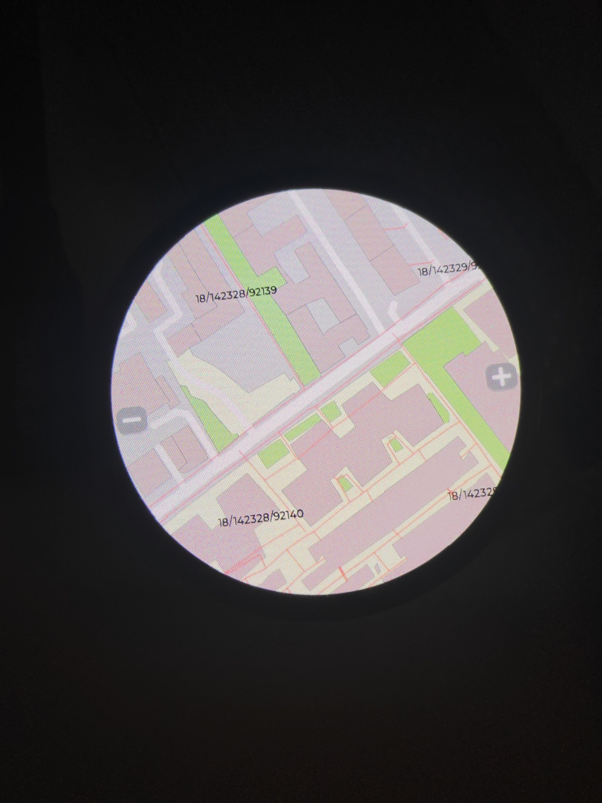
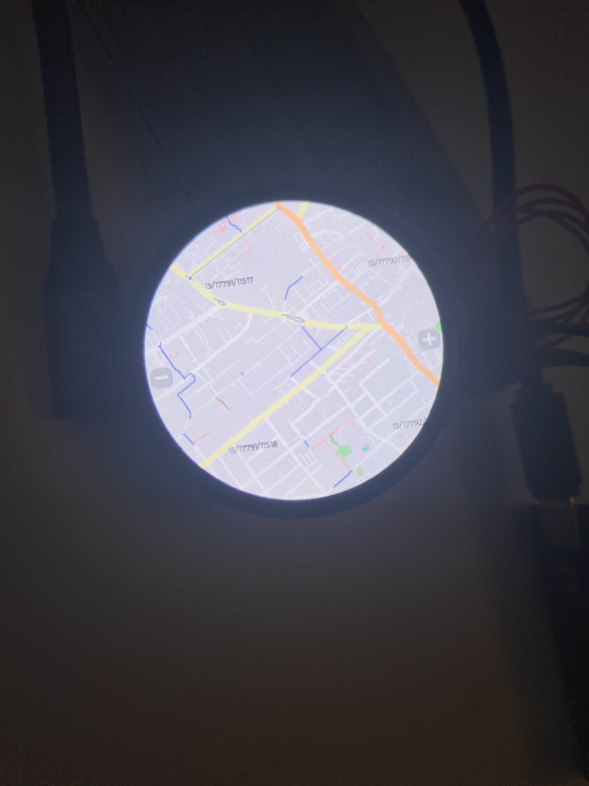

# embedded mapsforge renderer

Last year I tried to render mapsforge maps on embedded devices like the [Waveshare display with a raspberry pico](https://docs.waveshare.com/RP2350-Touch-AMOLED-1.75) with the goal to create a bicycle computer because i wasn't satisfied with the BSC300. Sadly, I lost interest and I don't have the time anymore to finish the project. 

But I succeeded in creating a mapsforge renderer. With the limited amount of ram (8mb psram and ~500kb internal) it works better than expected. Themes + the zoom where details are shown can be set inside [mapsforge_theme.c](mapsforge/mapsforge_theme.c). The video shows a style that is as close as possible to openstreetmaps. If you only want to render streets, it is blazingly fast.

# Features:
- full mapsforge format support (~500mb for austria)
- any zoom level
- any detail selectable (e.g. no highways if you want a cycle map)
- less than 20kb ram needed + 256*256*2 Bytes per tile in ram
- auto loading tiles when scrolling outside the current view
- fatfs integration to access sd card on MCUs
- any theme possible
- POI parsed (could be searched)
- Lvgl as graphics library. Highly portable
- 60fps if internal ram is used for display framebuffer

# TODO:
- GUI for other stuff (speed, position, settings...)
- GPS logging
- Caching of rendered tiles (zoom/x/y folder structure and saving the frame buffer) on sd card
- ...

No AI was used in this project but feel free to continue working on this with AI. Maybe I will continue in winter with the project and just vibe code the rest of it.

### Demo:
high res video in docs/

low detail full city view of graz -> detailed streets -> house view on zoom level higher than 18

 

